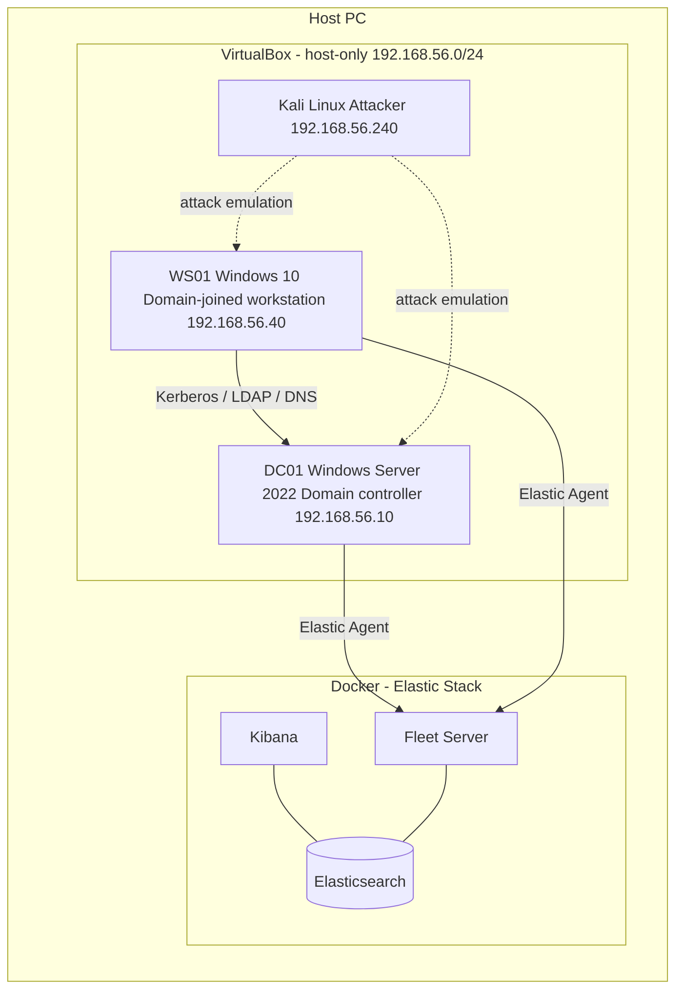

# Detection Lab

Isolated environment used to generate telemetry, replay attack techniques and validate detection rules in the Elastic Stack.

## Components

| Host | IP (static) | Role | Telemetry |
| --- | --- | --- | --- |
| DC01 | 192.168.56.10 | AD domain controller and DNS for `lab.local` | Security log, Sysmon, Elastic Agent |
| WS01 | 192.168.56.40 | Domain-joined workstation | Security log, Sysmon, Elastic Agent |
| Kali Linux | 192.168.56.240 | Attacker | None |
| Elasticsearch | Host (Docker) | Log storage and search | - |
| Kibana | Host (Docker) | Detection rules, alerting, analysis | - |
| Fleet Server | Host (Docker) | Agent enrollment and policy management | - |

Each VM has two adapters: NAT for Internet access, and the host-only network for lab traffic and log shipping.

## Configuration

- **Domain:** `lab.local`, WS01 joined to DC01.
- **Sysmon:** Olaf Hartong's sysmon-modular configuration, on DC01 and WS01.
- **Advanced audit policy (GPO):** Kerberos service ticket operations, logon events, directory service access (DCSync), account management.
- **Collection:** Elastic Agent managed by Fleet, Windows and Sysmon integrations.
- **Attack simulation:** Atomic Red Team on WS01.

## Validation

End-to-end chain tested with Atomic Red Team T1069.002 (Permission Groups Discovery: Domain Groups): the events reached Elasticsearch and the "Enumeration of Administrator Accounts" rule fired an alert in Kibana.

## Status

- [x] Host-only network and static addressing
- [x] DC01 deployed, WS01 joined to the domain
- [x] Advanced audit policy via GPO
- [x] Sysmon deployed
- [x] Elastic Agent enrolled on both Windows hosts
- [x] First Atomic Red Team test detected end to end
- [ ] Kali Linux integrated into the attack workflow
