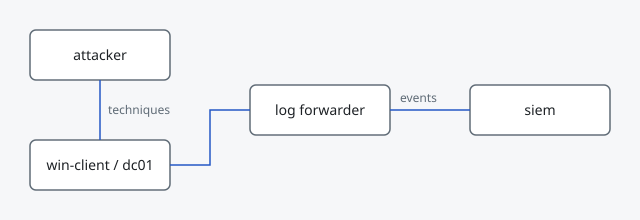

# Detection Lab

Isolated environment used to generate telemetry, run attack simulations and test detection rules.



## Goals

- Produce realistic endpoint and network telemetry.
- Centralize logs in a single SIEM for rule development.
- Replay attack techniques on demand to validate detections.

## Components

| Host | Role | Telemetry |
| --- | --- | --- |
| `win-client` | Windows 11 workstation | Sysmon, Windows Event Logs |
| `dc01` | Active Directory domain controller | Security log, PowerShell logs |
| `attacker` | Linux attack box | - |
| `siem` | Log collection and search | - |

## Setup notes

1. Create an isolated virtual network.
2. Deploy the Windows hosts and join `win-client` to the domain.
3. Install Sysmon with a baseline configuration.
4. Forward logs to the SIEM and confirm events arrive.

```powershell
# Example: install Sysmon with a configuration file
sysmon64.exe -accepteula -i sysmonconfig.xml
```

## Status

- [x] Network layout defined
- [ ] Hosts deployed
- [ ] Log forwarding validated
